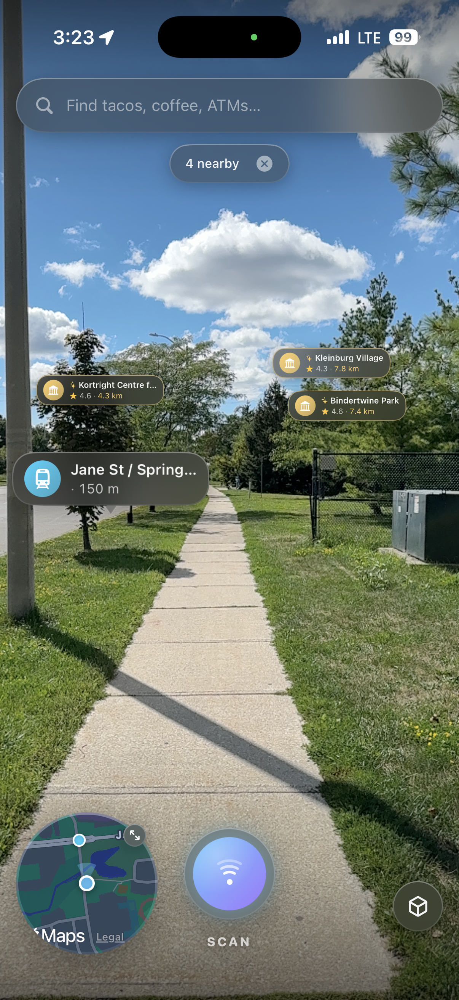
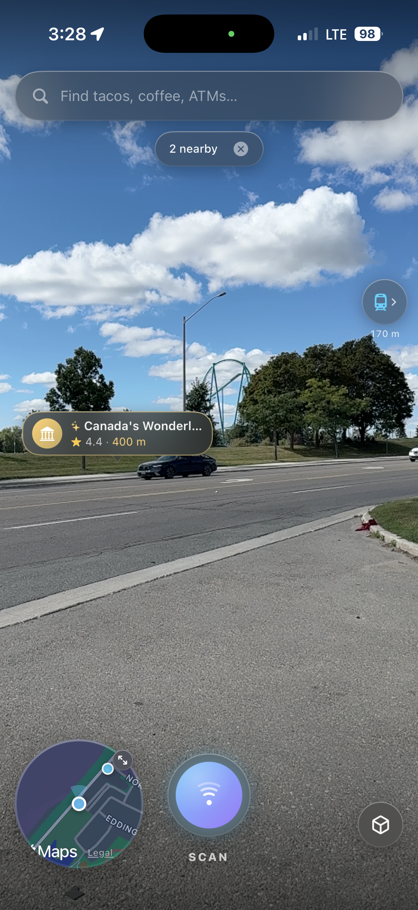
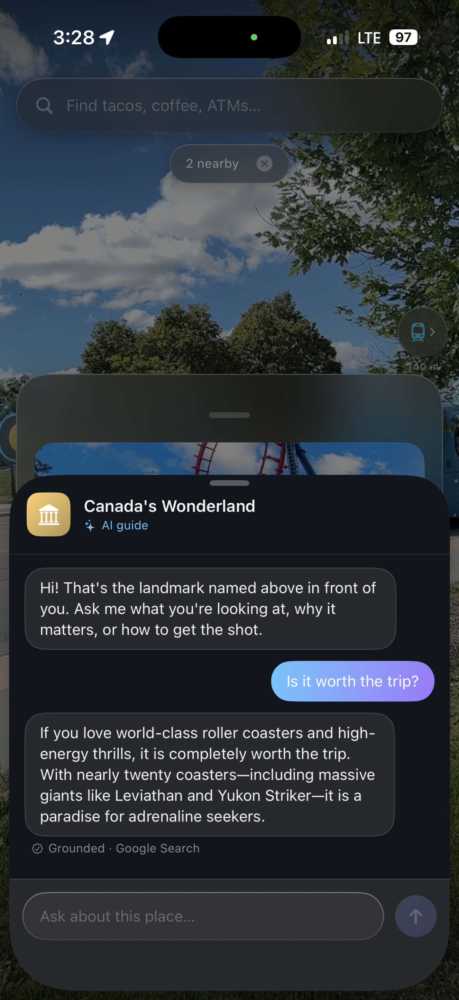

# Sightline

A SwiftUI discovery app for iOS. Point the camera at something — a tower 5 km away, a statue across the square, a café sign — tap Scan, and Sightline tells you what it is. The answer pins a bubble on the thing in the camera view, opens a card about it, and can walk you there or answer questions with an on-device AI guide.

Built on ARKit (camera and heading), Vision (sign text), Apple Foundation Models (image understanding and the AI guide, on device), and MapKit (candidate places, search, walking routes and the mini-map). Google Places supplies ratings, reviews, hours and a photo, and only when you open a card.

## How a scan works

1. Capture the camera frame with the heading, tilt and location at that moment.
2. Read sign text in the frame with on-device OCR.
3. Ask MapKit for notable places along the heading, out to about 25 km, plus nearby places whose name matches a sign. There is no small radius, so distance does not matter.
4. Give the image, the sign text and the numbered list to Apple's on-device model. It names what it can actually see and picks from the list. The list is only a hint: a place is never shown just because it is nearby.
5. Pin each result where the camera saw it (bearing and elevation). The pin does not depend on ground level, so scans work from a rooftop or an observation deck.

If the device has no vision-capable model, the scan falls back to sign matches, then to a notable place dead ahead.

## Requirements

- iOS 27 and an iPhone with Apple Intelligence turned on (for the scan model and the AI guide).
- Xcode 27.

## Setup

Copy `Sightline/Core/Secrets.swift.example` to `Sightline/Core/Secrets.swift` and add a Google Maps Platform key with Places API (New) enabled, restricted to the app's bundle id. Without a key, everything works except ratings, reviews and photos on the card.

## Screenshots

| Street view | Landmark lock-on | AI guide |
| :---: | :---: | :---: |
|  |  |  |

Screenshots are from the previous version, before the vision-based scan.

- **Street view** — bubbles float over what you scanned, with distance and rating.
- **Landmark lock-on** — a bubble stays on the landmark as you pan the phone.
- **AI guide** — tap a place to open an on-device AI chat about it.

## Privacy

Camera frames and AI chat never leave the device. Your location and typed searches go to Apple MapKit. When you open a card, the place's name and position go to Google Places. Nothing is stored or used for tracking.
